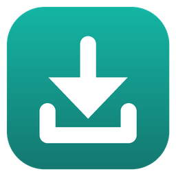
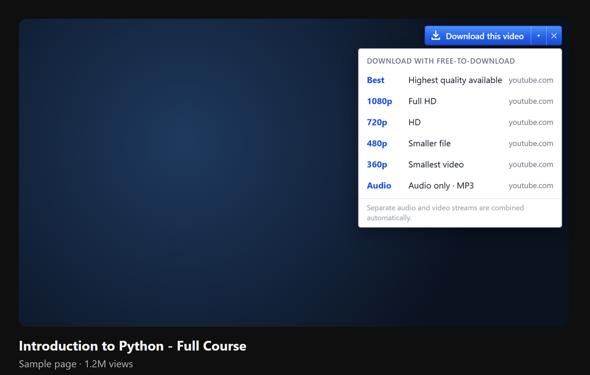
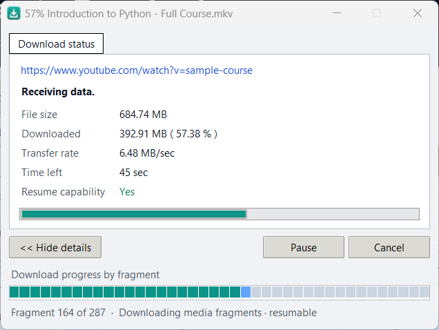
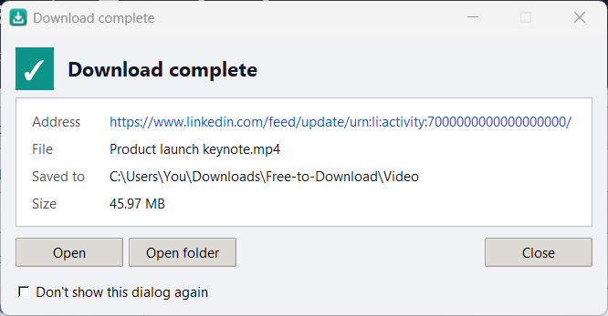
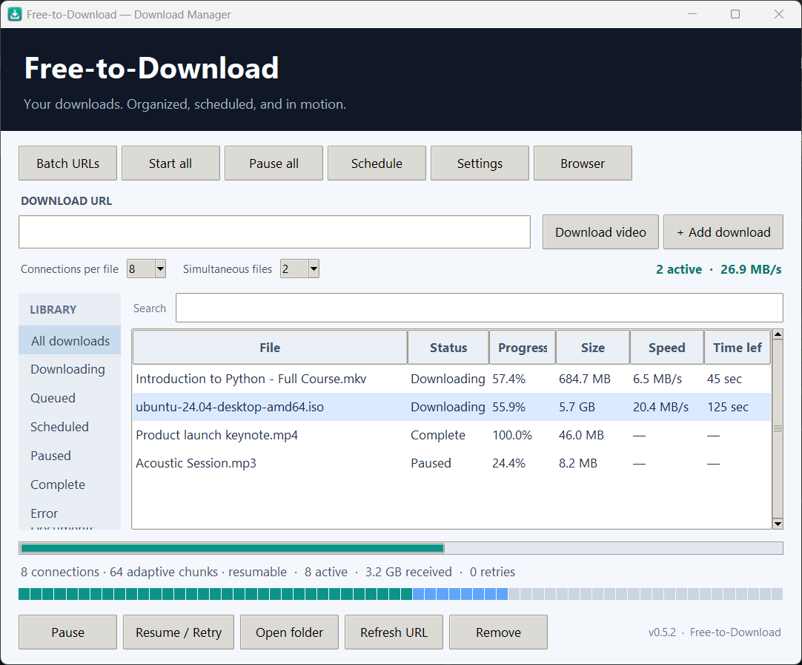
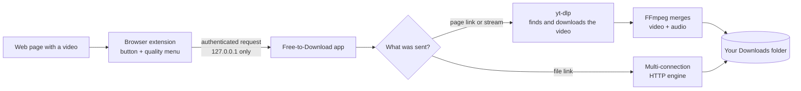

<p align="center">
  
</p>

<h1 align="center">Free-to-Download</h1>

<p align="center">
  A free, open-source download manager for Windows with a <b>“Download this video”</b> button in your browser.<br>
  Fast multi-connection downloads, resumable transfers, and video downloads in the quality you choose.
</p>

<p align="center">
  <a href="https://github.com/samihaider77/free-to-download/releases/latest"></a>
  <a href="https://github.com/samihaider77/free-to-download/actions/workflows/tests.yml"></a>
  <a href="LICENSE"></a>
  
</p>

<p align="center">
  <a href="https://github.com/samihaider77/free-to-download/releases/latest/download/Free-to-Download-Setup.exe"><b>⬇ Download for Windows</b></a>
  &nbsp;·&nbsp;
  <a href="https://samihaider77.github.io/free-to-download/">Website</a>
  &nbsp;·&nbsp;
  <a href="#install">Install guide</a>
</p>

<p align="center">
  
</p>

## Features

- **Download this video button** over videos on web pages, with a quality menu: Best, 1080p, 720p, 480p, 360p or audio only (MP3).
- **Works with streaming sites**: YouTube, LinkedIn posts, Vimeo, X and [many more](https://github.com/yt-dlp/yt-dlp/blob/master/supportedsites.md) via the page link, plus HLS (`.m3u8`) and DASH (`.mpd`) streams detected while the video plays.
- **Fast file downloads** with up to 16 parallel connections per file and adaptive chunk scheduling.
- **Pause and resume**, even after restarting the app, when the server supports it safely.
- **Progress window** for every download (speed, time left, per-connection or per-fragment progress) and a “Download complete” dialog with *Open* and *Open folder*.
- **Never overwrites your files.** Already-downloaded videos are recognised instead of downloaded twice.
- **Queue tools**: simultaneous-download limit, speed limiter, scheduled starts, batch URL import, categories, search and SHA-256 verification.
- **Private by design.** The browser extension talks only to the app on your own computer, over an authenticated local connection. No accounts, no tracking, no cookies collected.

<p align="center">
  
  &nbsp;
  
</p>

<p align="center">
  
</p>

## Install

Setup takes about two minutes and is done once. You need Windows 10 or 11 and Google Chrome
(Microsoft Edge and Brave work the same way — see [Using Edge or Brave](#using-edge-or-brave)).

### Step 1 — Download the installer

Click **[Download Free-to-Download-Setup.exe](https://github.com/samihaider77/free-to-download/releases/latest/download/Free-to-Download-Setup.exe)**
(or open the [latest release](https://github.com/samihaider77/free-to-download/releases/latest) and pick it under *Assets*).
If Chrome asks whether to keep the file, choose **Keep**.

### Step 2 — Run it

Double-click **Free-to-Download-Setup.exe** in your Downloads folder.

> **“Windows protected your PC”?** This blue screen appears because the app isn't code-signed yet.
> Click **More info**, then **Run anyway**. No administrator password is needed — the app installs just for you.

### Step 3 — Click through the installer

1. **Select Destination Location** — keep the suggested folder and click **Next**.
2. **Select Additional Tasks** — leave both boxes ticked and click **Next**:
   - *Create a desktop shortcut*
   - *Start Free-to-Download when I sign in to Windows (minimized)* — optional. Even without it, the
     browser starts the app by itself whenever you click a download.
3. **Ready to Install** — click **Install**.
4. **Completing setup** — leave all three boxes ticked and click **Finish**:
   - *Launch Free-to-Download*
   - *Add the browser button to Chrome*
   - *Open the extension folder*

Three windows now open: the **Free-to-Download app**, Chrome's **Extensions page**, and a File Explorer
window showing the **browser-extension folder**.

### Step 4 — Add the browser button to Chrome

On Chrome's Extensions page (`chrome://extensions`):

1. Switch on **Developer mode** (the toggle in the top-right corner).
2. Click **Load unpacked** (top-left).
3. In the folder picker, go to the **browser-extension** folder and click **Select Folder**.
   It's the folder that opened in File Explorer; its full path is
   `C:\Users\<your name>\AppData\Local\Programs\Free-to-Download\browser-extension`.
4. **Free-to-Download** appears in the list of extensions. Make sure its switch is **on** (blue).

> Opened the wrong folder? Pick the `browser-extension` folder itself — the one that contains `manifest.json` —
> not the main Free-to-Download folder.

### Step 5 — Pin the button and check the connection

1. Click the puzzle-piece icon (**Extensions**) in Chrome's toolbar and click the pin next to **Free-to-Download**.
2. Click the Free-to-Download icon, then **Settings**. It should say
   **✓ Connected to Free-to-Download** — the extension finds the app by itself; there is nothing to copy or paste.

### Step 6 — Download your first video

1. Open a page with a video (for example a YouTube video or a LinkedIn post) and let it play for a moment.
2. Click **Download this video** in the top-right corner of the video.
3. Pick a quality: **Best**, **1080p**, **720p**, **480p**, **360p**, or **Audio** (MP3).
4. A progress window shows the speed and time left. When it finishes, click **Open** or **Open folder**.

The app doesn't need to be open: if it's closed, the browser starts it automatically (minimized) and the
download begins a few seconds later. You can close the app window whenever you like.

Downloads are saved in `Downloads\Free-to-Download`, sorted into folders such as `Video` and `Music`
(change this in the app under **Settings**).
You can also paste any file or page link into the app's **Download URL** box.

### Updating to a new version

Download the new **Free-to-Download-Setup.exe** from the [latest release](https://github.com/samihaider77/free-to-download/releases/latest)
and run it — it updates in place and keeps your downloads, queue and settings. Then open `chrome://extensions`
and click **↻ Reload** on Free-to-Download (or restart Chrome).

### Uninstalling

Windows **Settings → Apps → Installed apps → Free-to-Download → Uninstall**, then click **Remove** on
Free-to-Download in `chrome://extensions`. Downloaded files are kept.

### Using Edge or Brave

Do Step 4 at `edge://extensions` (Edge: *Developer mode* is in the left sidebar) or `brave://extensions`.
In the app, **Browser → Open Edge extensions** opens the right page for you.

### Portable version (no installer)

Download **Free-to-Download-Portable.zip** from the [latest release](https://github.com/samihaider77/free-to-download/releases/latest),
extract it anywhere (for example your Desktop), run `Free-to-Download.exe`, and do Step 4 using the
`browser-extension` folder inside the extracted folder. Keep the folder where it is afterwards — Chrome loads
the extension from it.

### Troubleshooting

| What you see | What to do |
|---|---|
| “Free-to-Download is not running” | Open the app once from the Start menu. This registers it with your browser; after that the browser starts it by itself. |
| Settings says the app is closed | That's fine — it starts automatically when you download. Open it and click **Check again** to confirm the connection. |
| No **Download this video** button | Refresh the page and let the video play for a few seconds. On sites without a button, use the toolbar icon → *Download video from this page*. |
| Chrome shows “Disable developer mode extensions” | Click **✕**. The extension keeps working. (This goes away once the extension is on the Chrome Web Store.) |
| A download fails with an error | Some videos need a login, are DRM-protected, or are live streams; those can't be downloaded. |

> **Coming soon:** a Chrome Web Store listing. Then Step 4 disappears — after installing the app, Chrome simply
> shows *“New extension added”* and you click **Enable**.

## How it works



- **Desktop app** — Python + Tkinter (`app/`). The direct-file engine (`downloader.py`) splits a file into byte ranges and downloads them over persistent parallel connections. It resumes only when the server proves the file hasn't changed (strong ETag, validated ranges), and publishes the finished file atomically without ever overwriting an existing one.
- **Video downloads** (`media.py`) use [yt-dlp](https://github.com/yt-dlp/yt-dlp) to find and fetch the right streams, and [FFmpeg](https://ffmpeg.org) to combine audio and video into an MP4 that plays everywhere. A final check rejects results that contain no audio or video data, such as a stream header saved by mistake.
- **Browser extension** — Chrome Manifest V3 (`browser-extension/`). It adds the on-video button, notices media streams while a video plays, and sends your choice to the app.
- **Local bridge** (`bridge.py`) — an HTTP server bound to `127.0.0.1`. The extension pairs automatically: the app hands its token only to requests that the browser stamps with the extension's own fixed ID (`Origin: chrome-extension://…`), which web pages and other extensions cannot forge. Every download request is then checked for the token, origin, host and size.

## Build from source

Requirements: Windows 10/11, Python 3.12, Node.js (for the extension tests only).

```powershell
git clone https://github.com/samihaider77/free-to-download.git
cd free-to-download
python -m venv .venv
.venv\Scripts\activate
pip install -r requirements-build.txt

# Run from source
python app\main.py

# Tests
python -m unittest discover -s app -p "test_*.py"
node test_extension.cjs

# Build the app (dist\Free-to-Download\Free-to-Download.exe)
python -m PyInstaller --noconfirm --distpath dist --workpath build packaging\free-to-download.spec
```

The installer is built with [Inno Setup](https://jrsoftware.org/isinfo.php): `iscc /DAppVersion=0.6.0 packaging\installer.iss`.
Store publishing steps are in [`packaging/store-listing.md`](packaging/store-listing.md).

**Releases are automated.** Pushing a tag such as `v0.6.0` runs [`release.yml`](.github/workflows/release.yml), which tests, builds, smoke-tests the packaged app with real downloads, and publishes the installer, portable ZIP and checksums. Keep `app/version.py` and `browser-extension/manifest.json` at the same version as the tag.

## Project structure

```
app/                 desktop app (UI, download engines, local bridge) and its tests
browser-extension/   Chrome/Edge extension (video button, stream detection, popup, pairing)
packaging/           PyInstaller spec, Inno Setup installer script, icon, release notes
docs/                project website (GitHub Pages) and screenshots
.github/workflows/   tests on every push; build and publish on version tags
```

## Responsible use

Free-to-Download is meant for videos and files you own or have permission to download, such as your own uploads, public-domain or Creative Commons media, and course or work material you're allowed to save. Respect each website's terms of service and copyright law. It does **not** bypass DRM or other copy protection, and it does not record live streams.

## Roadmap

- Chrome Web Store / Edge Add-ons listing (one-click extension install)
- Code-signed releases (no SmartScreen warning)
- In-app updates for the app and its yt-dlp engine
- Show real available qualities and file sizes in the video menu
- Browser-cookie support for videos that need a login

Ideas and bug reports are welcome in [Issues](https://github.com/samihaider77/free-to-download/issues).

## License

Free-to-Download is released under the [MIT License](LICENSE).
The Windows build bundles third-party software under its own licences, including FFmpeg (GPLv3), yt-dlp (Unlicense) and Python (PSF). See [THIRD-PARTY-NOTICES.md](THIRD-PARTY-NOTICES.md).
